<p align="center">
  
</p>

<h1 align="center">SyncMesh</h1>

<p align="center">
  <a href="https://github.com/nihalmachhi/SyncMesh/actions/workflows/ci.yml"></a>
  <a href="LICENSE"></a>
</p>

SyncMesh is an educational offline-first inventory replication demo. Each node owns a separate SQLite database and can accept local inventory writes while peers are unreachable. Nodes exchange immutable operations when they can communicate.

## How it works

Each SyncMesh node commits local inventory changes as immutable operations in its own SQLite database. Peers exchange missing operations and apply them idempotently.

```mermaid
flowchart LR
  A[Local inventory edit] --> B[Create sequenced operation]
  B --> C[SQLite operation log and local view]
  C --> D[Exchange version vectors with peers]
  D --> E[Send missing operations]
  E --> F[Validate order and ignore duplicates]
  F --> G[Resolve concurrent field edits]
  G --> H[Peer SQLite view]
  H --> I[React Router dashboard]
```



Per-origin sequence numbers and version vectors identify gaps and missing changes. Field updates use per-field hybrid logical clock registers. Peer and admin endpoints support timestamped HMAC and bearer-token checks when secrets are configured. This remains an educational lab; use TLS for traffic outside a trusted network.

## Start the demo

Requirements: Docker Desktop with its engine running.

```powershell
docker compose up --build
```

Open http://localhost:5173. Select a node, add an item, and use **Sync now** to exchange operations. The dashboard refreshes node status every five seconds. API docs are available at http://localhost:8001/docs, ports 8002 and 8003 expose the other nodes.

Stop with Ctrl+C or `docker compose down`. To erase node data too, run `docker compose down -v`. The architecture and run flow are in [the project guide](docs/guide.md).

## How replication works

A local change is written as an immutable operation with a node ID, per-origin sequence, entity, operation type, payload, base vector, and UTC timestamp. SQLite records the operation and updates that node's inventory view in the same transaction. Peers exchange version vectors and transfer missing operations. Duplicate delivery is ignored, and gaps are buffered until preceding sequence numbers arrive.

Quantity changes use additive deltas, so independent updates commute. Field edits use causal ordering and a deterministic hybrid-clock/node/operation tie-break for concurrent edits. Causally incomplete operations remain buffered. Deletes are retained as tombstones. Concurrent edits to the same field create an open conflict record and can be resolved with an ordinary later operation. Changes are recorded atomically in the SQLite log and materialized view.

## Claims and proof

| Claim | Evidence |
|---|---|
| Concurrent field edits converge across delivery permutations and duplicate delivery | Randomized property test: `tests/property/test_convergence.py` |
| Seeded operation schedules converge under reordering and duplication | Generated report: `reports/reproduce.json` (`make reproduce`) |
| Peer graph and causal history summaries are deterministic | `tests/unit/test_graphs.py` |
| Duplicate suggestions are evaluated on synthetic labeled examples | `reports/reproduce.json`; ten pairs only, not real catalog accuracy |
| Peer log digests identify changed and absent ranges | `tests/unit/test_digest.py` |
| Compaction waits for every peer and stale peers bootstrap from snapshots | `tests/unit/test_snapshot.py`, `tests/unit/test_sync.py` |
| More than one operation page can synchronize | In-process HTTP integration test: `tests/unit/test_sync.py` |
| Peer batches are validated atomically and bounded to 500 operations | `tests/unit/test_regressions.py` |
| Operations waiting on missing causal dependencies are buffered | `tests/unit/test_regressions.py` |
| Admin and peer endpoints require configured credentials outside development mode | `tests/unit/test_regressions.py` |
| Phase 1 suite coverage is at least 85% | `uv run pytest` coverage gate |

## Project layout

- `src/syncmesh/core`: environment settings and shared errors.
- `src/syncmesh/protocol`: validated operation messages and vector-clock functions.
- `src/syncmesh/domain`: pure inventory state transitions.
- `src/syncmesh/core/security.py`: admin bearer and peer HMAC checks.
- `src/syncmesh/graphs`: causal history, antichain, and peer partition analysis.
- `src/syncmesh/simulation`: seeded operation schedules and report generation.
- `src/syncmesh/nlp` and `src/syncmesh/vision`: optional local catalog and image helpers.
- `src/syncmesh/node/api.py`: FastAPI app factory and router registration.
- `src/syncmesh/node/routers`: item, sync, admin, and event endpoints.
- `src/syncmesh/node/services/sync.py`: asynchronous peer exchange loop.
- `src/syncmesh/node/storage`: per-node SQLite lifecycle, schema, and repository.
- `dashboard/src`: React + TypeScript dashboard using React Router.
- `tests/unit`, `tests/property`: API, migration, sync, regression, and convergence checks.
- `docs`: project learning guide.

## Local development

Requires Python 3.12+ and uv.

```powershell
uv sync --extra dev
uv run pytest
uv run ruff check src tests
uv run mypy src
docker compose config -q
cd dashboard
npm ci
npm run build
```

Run one API node locally with `uv run uvicorn syncmesh.node.main:create_app --factory --app-dir src --reload`. Configure it using `SYNCMESH_NODE_ID`, `SYNCMESH_DB_PATH`, and `SYNCMESH_PEERS`. `.env.example` lists development settings; real `.env` files are ignored by Git. Outside development, set `SYNCMESH_ENVIRONMENT=production`, `SYNCMESH_ADMIN_TOKEN`, and `SYNCMESH_PEER_SECRET`.

## Scope

This is a learning prototype, not a production database. It does not provide encrypted transport or peer discovery. Hash-range digests and byte-budgeted causal selection reduce redundant exchanges in the model; simulator byte counts are estimates, not measured HTTP performance. NLP and vision are optional local suggestions, not automatic inventory edits. Optional authentication does not replace TLS or a production identity system. Keep demo endpoints on a trusted local network.

## License

SyncMesh is available under the [MIT License](LICENSE).

