# SyncMesh

SyncMesh is an educational offline-first inventory replication demo. Each node owns a separate SQLite database and can accept local inventory writes while peers are unreachable. Nodes exchange immutable operations when they can communicate.

## How it works

Each SyncMesh node commits local inventory changes as immutable operations in its own SQLite database. Peers exchange missing operations and apply them idempotently.

```mermaid
flowchart LR
  A[Local inventory edit] --> B[Create sequenced operation]
  B --> C[SQLite operation log and local view]
  C --> D[Exchange version vectors with peers]
  D --> E[Send missing operations]
  E --> F[Validate order and ignore duplicates]
  F --> G[Resolve concurrent field edits]
  G --> H[Peer SQLite view]
  H --> I[React Router dashboard]
```



Per-origin sequence numbers and version vectors identify gaps and missing changes. Quantity updates use additive deltas; concurrent field edits use a deterministic tie-break and record the resolution. This is an educational prototype without authentication or encrypted peer transport.

## Start the demo

Requirements: Docker Desktop with its engine running.

```powershell
docker compose up --build
```

Open http://localhost:5173. Select a node, add an item, and use **Sync now** to exchange operations. The dashboard refreshes node status every five seconds. API docs are available at http://localhost:8001/docs, ports 8002 and 8003 expose the other nodes.

Stop with Ctrl+C or `docker compose down`. To erase node data too, run `docker compose down -v`. The architecture and run flow are in [the project guide](docs/guide.md).

## How replication works

A local change is written as an immutable operation with a node ID, per-origin sequence, entity, operation type, payload, base vector, and UTC timestamp. SQLite records the operation and updates that node's inventory view in the same transaction. Peers exchange version vectors and transfer missing operations. Duplicate delivery is ignored, and gaps are buffered until preceding sequence numbers arrive.

Quantity changes use additive deltas, so independent updates commute. Field edits use causal ordering and a deterministic timestamp/node/operation tie-break for concurrent edits. Deletes are retained as tombstones. The implementation records concurrent field conflict resolutions in SQLite.

## Project layout

- `src/syncmesh/common`: environment settings and shared errors.
- `src/syncmesh/protocol`: validated operation messages and vector-clock functions.
- `src/syncmesh/node/api.py`: FastAPI routes, startup, and WebSocket status.
- `src/syncmesh/node/services/sync.py`: asynchronous peer exchange loop.
- `src/syncmesh/node/storage`: per-node SQLite lifecycle, schema, and repository.
- `frontend/src`: React + TypeScript dashboard using React Router.
- `tests/unit`: repository and version-vector checks.
- `docs`: guide source and generated PDF.

## Local development

Requires Python 3.12+ and uv.

```powershell
uv sync --extra dev
uv run pytest
uv run ruff check src tests
uv run mypy src
cd frontend
npm ci
npm run build
```

Run one API node locally with `uv run uvicorn syncmesh.node.main:app --app-dir src --reload`. Configure it using `SYNCMESH_NODE_ID`, `SYNCMESH_DB_PATH`, and `SYNCMESH_PEERS`. `.env.example` lists defaults; real `.env` files are ignored by Git.

## Scope

This is a learning prototype, not a production database. It has no authentication, encrypted transport, peer discovery, operation-log compaction, or full production conflict-review workflow. Keep demo endpoints on a trusted local network. No performance benchmarks are claimed.

