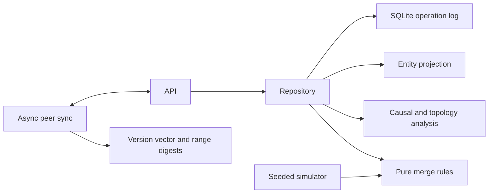

# Architecture

Each node owns one SQLite database. The FastAPI app factory creates the
repository, routers, metrics registry, rate limiter, and background peer
synchronizer. Local writes append an immutable operation and update the
materialized inventory in the same transaction.

The static project site in `site/` is an independent, browser-only walkthrough and simulator; it does not call the FastAPI nodes. The project also contains optional local NLP duplicate suggestions and vision helpers. Install them with the `[nlp]` and `[vision]` extras respectively.
