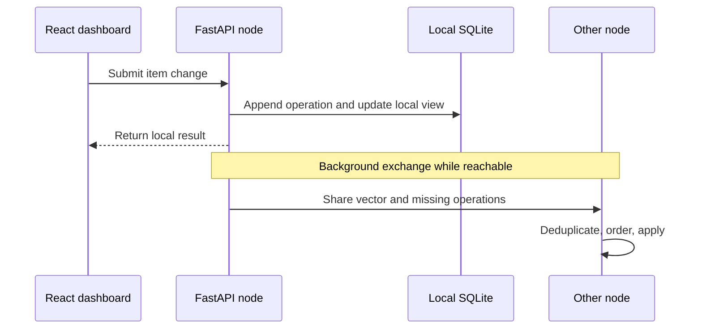
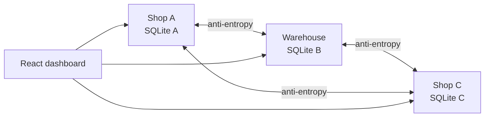

# Understanding SyncMesh

## What the system does
A location saves an inventory change to its own SQLite database first. Network availability controls when other nodes learn about the change, not whether the local write completes.

## Operations and causal progress
Each mutation is an immutable operation with an origin and sequence ID, entity, type, payload, base vector, and UTC timestamp. A vector such as `{shop-a: 12, shop-b: 4}` means this replica has applied through sequence 12 from shop-a and 4 from shop-b. Missing sequences wait in a pending queue; repeated delivery is safe because operation IDs are unique.

## Conflict rules
A causally later field edit wins. Concurrent edits use UTC wall time, then node and operation IDs for deterministic tie-breaking. Stock adjustments are additive, so concurrent sales of 2 and 3 reduce stock by 5 regardless of delivery order. Deletes are tombstones. Conflicts needing review remain available from the API.

## Independent replicas

Compose creates three services and three named volumes. No node reads another node's SQLite file. The dashboard reads each API independently and lets you choose which replica to inspect.

## Run and explore
Start Docker Desktop, run `docker compose up --build` from the project root, and open `http://localhost:5173`. Create an item and switch between the node cards. Use **Sync now** to request exchange. Stop one node, create a change elsewhere, restart it, and sync to observe reconnection. API routes include `/health`, `/items`, `/sync/vector`, `/sync/exchange`, `/stats`, and `/conflicts`.

## Prototype boundaries
This learning build demonstrates independent local stores, operation exchange, deduplication, ordering, version vectors, additive stock, tombstones, and deterministic conflict resolution. It does not include authentication, encrypted transport, dynamic discovery, compaction, or production monitoring. Run it on a trusted demo network.
